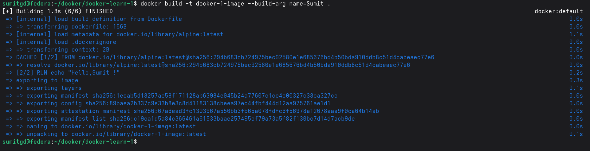

# Docker Learn 1

A simple Docker learning project that demonstrates how to use `ARG` variables and execute basic shell commands during the Docker image build process using Alpine Linux.

**Project Page URL:**(https://roadmap.sh/projects/basic-dockerfile)

## Prerequisites

- [Docker](https://docs.docker.com/get-docker/) must be installed and running on your system.
    

## Project Structure

- `Dockerfile`: Contains the instructions to build the Alpine-based image.
    

## How to Build the Image

Open your terminal, navigate to the `docker-learn-1` directory, and run the following command to build the image. By default, it will use the name "Sumit" as defined in the `Dockerfile`.

```
docker build -t docker-1-image .
```

### Passing a Custom Name

You can override the default `ARG` value during the build process by using the `--build-arg` flag:

```
docker build -t docker-1-image --build-arg name=Captain .
```

_(Note: Because the `echo` command is tied to a `RUN` instruction, you will see the output "Hello,Captain !" in the terminal logs during the build process itself.)_

